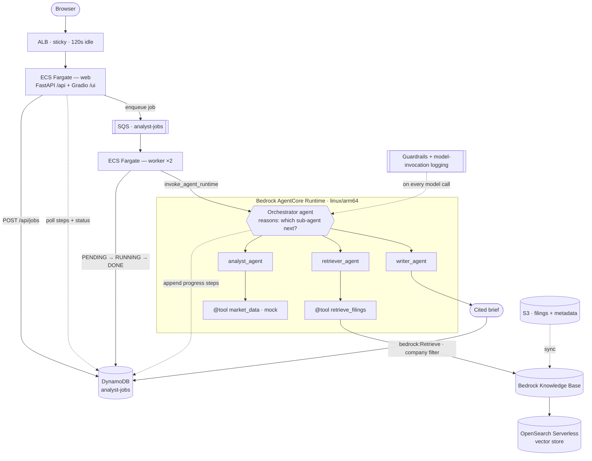

# Financial Research Analyst Agent

A production-grade multi-agent AI system that researches companies from SEC filings and market data, then produces **cited analyst briefs** with live progress feedback. Built on **Amazon Bedrock**, **Strands Agents**, and **AgentCore Runtime**.

## Features

✅ **Multi-agent orchestration** — dynamic routing between retriever, analyst, and writer specialists  
✅ **Cited briefs** — all claims backed by `[1]`, `[2]` citations to actual filing passages  
✅ **Live progress feed** — watch the agent decide, retrieve, analyze, and draft in real-time  
✅ **Guardrails & logging** — every model call guarded + audit trail to S3/CloudWatch  
✅ **Background job queue** — SQS + ECS workers handle long-running analyses asynchronously  
✅ **Web UI + REST API** — Gradio chat interface + FastAPI endpoints  

## Quick Start (Local)

### Prerequisites
- Docker with buildx (for `linux/arm64` agent image)
- Python 3.12
- AWS CLI configured
- AWS account with Bedrock model access (Amazon Nova 2 Lite, Titan Embeddings V2)

### 1. Prepare environment
```bash
cp .env.example .env
# Fill in: AWS_REGION, BEDROCK_MODEL_ID, KB_ID (you'll create this next)
```

### 2. Create Knowledge Base (AWS Console)
1. **Bedrock Console** → **Knowledge Bases** → **Create**
2. Name: `analyst-filings-kb`
3. Data source: S3 bucket with filings
4. Embeddings: Titan Text Embeddings V2
5. Vector store: OpenSearch Serverless (auto-provisioned)
6. **Sync** the data source
7. Copy the KB ID into `.env`

### 3. Seed sample data
```bash
# Upload Apple & Microsoft 10-K docs to S3
aws s3 sync seed/filings/ "s3://${FILINGS_BUCKET}/filings/"

# Seed company lookup table
AWS_REGION=us-east-1 python seed/seed_db.py
```

### 4. Run locally
```bash
docker compose up --build
```

Open **http://localhost:8000/ui** → submit a company (e.g., "Apple")

The browser shows:
- Live progress steps ("🔎 pulling filings", "📊 analyzing", "✍️ drafting")
- Final **cited brief** with [1], [2] citations + Sources list

## Architecture



### REST API
```bash
# Submit job
curl -X POST http://alb-dns/api/jobs \
  -H 'Content-Type: application/json' \
  -d '{"company":"Apple"}'
# → {"job_id":"abc-123", "status":"PENDING"}

# Poll status
curl http://alb-dns/api/jobs/abc-123
# → {"job_id":"...", "status":"DONE", "result":"...", "steps":[...], "company":"Apple"}

# Health check
curl http://alb-dns/api/health
# → {"status":"ok"}
```

## How It Works

### Request Flow

1. **User submits company** → `/api/jobs` creates DynamoDB record (PENDING), enqueues SQS message
2. **Worker polls SQS** → receives message, marks job RUNNING
3. **Worker invokes AgentCore Runtime** with company name + job ID
4. **Orchestrator agent** (Strands) reasons about the plan:
   - Call retriever_agent to pull relevant passages from filings
   - Evaluate coverage; optionally call retriever again with different query
   - Call analyst_agent to extract financials, risks, outlook
   - Call writer_agent to compose final brief with [n] citations
5. **Sub-agents emit progress** (e.g., "🔎 pulling filings") → appended to job's `steps` list in DynamoDB
6. **UI polls every 2 seconds** → renders new progress steps as they arrive
7. **Worker saves result** → job marked DONE, brief written to DynamoDB
8. **UI renders brief** with [n] citations mapped to Sources list

### Tools

**`retrieve_filings(query, company)`**  
Calls `bedrock-agent-runtime:Retrieve` on the Knowledge Base. Filters by company metadata (set at ingestion via `.metadata.json` sidecars). Returns numbered passages with S3 URIs for citation.

**`market_data(ticker)`**  
Returns current price, P/E, market cap, revenue growth. Default is mock data; can be swapped for real API (Alpha Vantage, Polygon, etc.).

### Model & Costs

- **Model**: Amazon Nova 2 Lite (small, cost-effective)
- **Swap to Nova 2 Pro** for higher quality (change one env var)
- **Pricing**: Pay per-token on Bedrock; SQS/DynamoDB on-demand; OpenSearch Serverless by OCU + data scanned

## Local Testing (pytest)

```bash
pip install -r app/requirements.txt -r tests/requirements-dev.txt
pytest -q
```


## Cost Discipline

**Between sessions, delete/scale to zero:**
- OpenSearch Serverless collection (KB detail → delete)
- AgentCore Runtime (console → delete)
- ECS services (desired count = 0)
- SQS queue
- DynamoDB (on-demand; no charge if idle)

Keep a **billing alarm** on your AWS account.

## Architecture Highlights

- **Dynamic routing**: Orchestrator reasons about which sub-agent to call next, not a fixed pipeline
- **Budget-aware**: `MAX_SUBAGENT_CALLS` prevents runaway loops
- **Cited research**: Every claim in the brief backs to a passage + source URI
- **Async by design**: Background jobs don't block the UI; progress streams live
- **Guardrailed**: Every LLM call guarded; full audit trail in CloudWatch + S3
- **Scalable**: Fargate workers auto-scale; SQS decouples; DynamoDB on-demand

## Contributing

To extend this system:
1. Add new tools to `agent/tools.py`
2. Update orchestrator prompt in `agent/orchestrator.py`
3. Rebuild agent image + restart runtime
4. Test via UI or API
