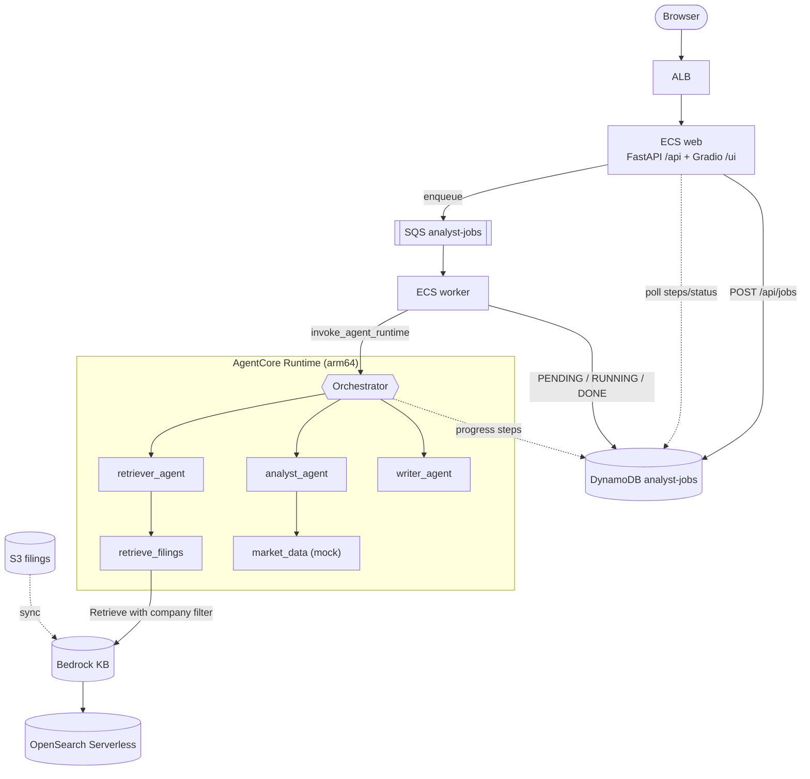

# Financial Research Analyst Agent

I built this to learn Bedrock AgentCore and Strands properly. You give it a company name, it pulls passages from that company's 10-K filings, looks at some market data, and writes a short analyst brief where every claim points back to the filing it came from. While it works, the UI shows what step it is on, so you aren't staring at a spinner for a minute.

Stack: Amazon Bedrock (Nova 2 Lite + a Knowledge Base), Strands Agents, AgentCore Runtime, FastAPI, Gradio, SQS, DynamoDB, ECS Fargate.

## What it does

- An orchestrator agent decides which sub-agent to call next (retriever, analyst, writer) instead of running a fixed pipeline. It can go back to the retriever if it doesn't have enough to work with.
- The brief uses [1], [2] style citations with a Sources list at the end mapping to the S3 documents.
- Progress steps are written to DynamoDB as the agent runs, and the UI polls them.
- Jobs go through SQS so a long analysis doesn't hold an HTTP request open.
- If you set a Guardrail ID, every model call goes through it.

## Running it locally

You'll need Docker with buildx (the agent image is linux/arm64), Python 3.12, the AWS CLI configured, and model access in Bedrock for Nova 2 Lite and Titan Embeddings V2.

**1. Env file**

```bash
cp .env.example .env
```

Fill in AWS_REGION, BEDROCK_MODEL_ID and KB_ID. You'll get the KB ID in the next step.

**2. Knowledge Base**

I created this in the console, it was quicker than scripting it:

1. Bedrock console > Knowledge Bases > Create
2. Name it `analyst-filings-kb`
3. Data source: the S3 bucket with the filings
4. Embeddings: Titan Text Embeddings V2
5. Vector store: OpenSearch Serverless (let it create one)
6. Sync the data source
7. Put the KB ID in `.env`

**3. Sample data**

There are two synthetic 10-Ks in `seed/filings` (Apple and Microsoft). The `.metadata.json` files next to them set the company attribute, which the retriever filters on.

```bash
aws s3 sync seed/filings/ "s3://${FILINGS_BUCKET}/filings/"
AWS_REGION=us-east-1 python seed/seed_db.py
```

**4. Start it**

```bash
docker compose up --build
```

Then open http://localhost:8000/ui and try "Apple". You should see steps like "pulling filings", "analyzing", "drafting" come in, then the brief.

Locally the agent still talks to real Bedrock and the real KB. Only DynamoDB goes to LocalStack (that's what DDB_ENDPOINT_URL is for).

## Architecture



Roughly what happens on a request:

1. `POST /api/jobs` writes a PENDING job to DynamoDB and puts a message on SQS.
2. A worker picks it up, marks it RUNNING, and invokes the AgentCore Runtime with the company and job ID.
3. The orchestrator usually calls the retriever first, maybe a second time with a different query, then the analyst, then the writer.
4. Each step appends to the job's `steps` list in DynamoDB. The UI polls every 2 seconds.
5. The worker saves the brief and marks the job DONE (or FAILED with the error).

## API

```bash
curl -X POST http://localhost:8000/api/jobs \
  -H 'Content-Type: application/json' \
  -d '{"company":"Apple"}'
# {"job_id":"abc-123","status":"PENDING"}

curl http://localhost:8000/api/jobs/abc-123
# {"job_id":"...","status":"DONE","result":"...","steps":[...],"company":"Apple"}

curl http://localhost:8000/api/health
```

## Tools

`retrieve_filings(query, company)` calls Retrieve on the Knowledge Base, filtered by the company metadata, and returns numbered passages with their S3 URIs so the writer can cite them.

`market_data(ticker)` returns price, P/E, market cap and revenue growth. It's mock data for now. Swapping in Alpha Vantage or Polygon should only touch `agent/market.py`.

## Model and cost

I used Nova 2 Lite because it's cheap and good enough for this. For better briefs, change BEDROCK_MODEL_ID to Nova 2 Pro. MAX_SUBAGENT_CALLS stops the orchestrator from looping forever if it gets confused.

The thing that actually costs money when idle is OpenSearch Serverless. When I'm not using it I delete the collection and the AgentCore Runtime and scale the ECS services to 0. DynamoDB on-demand and SQS cost basically nothing when idle. Set a billing alarm.

## Adding things

New tools go in `agent/tools.py`. Then update the orchestrator prompt in `agent/orchestrator.py` so it knows the tool exists, rebuild the agent image, and update the runtime.
